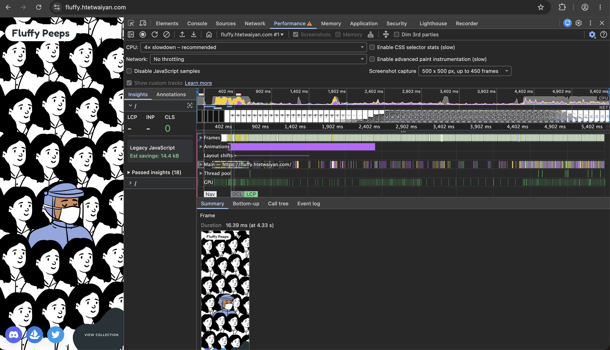

# Fluffy Peeps: Animated Landing Page

Part 1 of the Rezerv Frontend Engineering assessment (UI Animation Challenge).

**Live URL:** https://fluffy.htetwaiyan.com/

## Setup

You'll need Node 20 or newer.

```bash
npm install
npm run dev      # http://localhost:3000
npm run build && npm run start
npm run lint
```

## Sections

The original reference ([nft.fluffyhugs.io](https://nft.fluffyhugs.io/)) doesn't load, so I
followed the working sample ([fluffy-animation.vercel.app](https://fluffy-animation.vercel.app/))
instead. It has exactly three screens, so I built those three:

1. **Loader**
2. **Scene 1:** a crowd of hopping items with a unique one standing in the middle.
3. **Scene 2:** lying with blobs flowing up in background

The social icons and the "View collection" button stay on screen in both scenes. As the
instructions say, they react to hover but don't go anywhere.

## Libraries

- **Next.js + TypeScript:** I chose Next.js so the HTML is rendered on the server, and
  `next/font` / `next/image` handle fonts and image sizing.
- **SCSS modules:** one style file per component, so styles can't leak between them.
- **GSAP (+ Observer):** I picked it for timelines, so I can play the whole scene change
  forwards or backwards as one unit. Its Observer plugin turns wheel and swipe gestures into
  "next" and "back" (see below).
- **Why no Lenis:** I started with Lenis plus ScrollTrigger, because the first version had two
  scenes on one scroll: scroll down to scene 2, scroll up to scene 1. Then I changed it to loop
  like the reference: every scroll down flips to the other scene, forever. A loop has no
  end, so there's no scroll position to track or smooth, and the page doesn't need to scroll at
  all. GSAP's Observer does the same job, so I removed Lenis: one dependency fewer.

## Animation, scroll and responsiveness

- **On load:** once the loader has faded out, the crowd rises in, the nurse pops up, then the
  title and buttons. The entrance hides the crowd in the same React render that starts the
  fade, so the finished crowd never flashes first. Each row starts just below the screen,
  measured from its own top: on phones the back rows sit above the screen, and moving every
  row down by one screen brought them into view.
- **On scroll:** the page doesn't scroll. GSAP's Observer reads wheel and touch swipes:
  scrolling down flips to the other scene (1 → 2 → 1 …), scrolling up goes back to scene 1.
  Gestures during a change are ignored, so one long swipe can't flip it back and forth. The
  scene plays by time, not by scroll distance, so it never stops halfway.
- **Why not real scrolling on mobile:** with a scrolling page, iOS momentum fought the
  auto-scroll (stutter), and the address bar showing and hiding resized the screen mid-animation
  (flicker). Gestures with no page scroll avoid both. `overscroll-behavior: none` stops the
  rubber-band bounce that iOS does even on a page that can't scroll.
- **On hover:** CSS transitions, only on devices with a mouse, so touch screens don't get stuck
  in a hover state.
- **On resize:** most sizes come from one value (`--cell`), so everything scales together. On
  portrait screens I size the peeps from the width, because they were far too big.
- **Hop delays:** each peep gets its own delay from a seeded random generator
  ([mulberry32](https://github.com/bryc/code/blob/master/jshash/PRNGs.md#mulberry32)). I used a
  seed instead of `Math.random()` so the server and browser render the same HTML.

## Performance

Recorded on the live site in Chrome DevTools, CPU slowed down 4x (load, then scene 1 → 2):



- The Frames track stays green: about 16.7ms per frame (60fps) through the scene change. CLS is 0.
- One 67ms task while the loader is still covering the page. It's React hydrating the 160 crowd
  images. Nobody can click yet, so I left it.
- I only animate `transform` and `opacity`, because they don't trigger layout. Hidden parts
  pause their CSS animations.
- The wordmark grows about 4x in scene 2. Scaling text up made the browser redraw it every
  frame, and the letters shimmered on phones. So CSS draws it at its big size and shrinks it
  for scene 1, on its own layer (`will-change: transform`). The scene only ever scales it down,
  which stays sharp, and the redraw cost dropped by about two thirds (4x CPU slowdown).
- 311KB first load. All 160 crowd peeps share one 15KB SVG, and I only load the two font weights
  on screen.
- On a slow network, the counter counts in CSS until the JS arrives, so it never sits at 0%.

## Accessibility and reduced motion

- With reduced motion turned on, I switch off the hops, the blob flow and the entrance. I didn't want to just remove the scene change, though, because then scene 2
  would be unreachable, so it becomes a short fade where nothing moves across the screen.
- Decorative images use `alt=""` or `aria-hidden`, icon buttons have labels, and every button
  shows a focus outline for keyboard users.
- If JavaScript is off, I hide the loader so the page is still visible.

## Assumptions

- Since the original reference is unreachable, I assumed
  [fluffy-animation.vercel.app](https://fluffy-animation.vercel.app/) shows the intended design
  and motion, and used it as my reference.
- The instructions allow my own assets, so I used [Open Peeps](https://www.openpeeps.com)
  characters instead of the reference's artwork.
- I took the "View collection" blob outline from the reference. I tried a few shapes of my own,
  but none of them read as well; everything else about the button is my own.
- I assumed a reload should always start at scene 1, because the page tells a short story from
  the loader to scene 2.

## With more time

- I'd make a WebP version of the crowd peep, since redrawing 160 SVGs is the most expensive
  thing when you zoom the browser.
- I'd add Playwright tests for the scene loop, especially resize mid-change and fast swipes.
- I'd let the arrow keys and Page Down flip the scenes too. All the content is reachable in
  both scenes, so it's not required, but keyboard users would get the animation.
